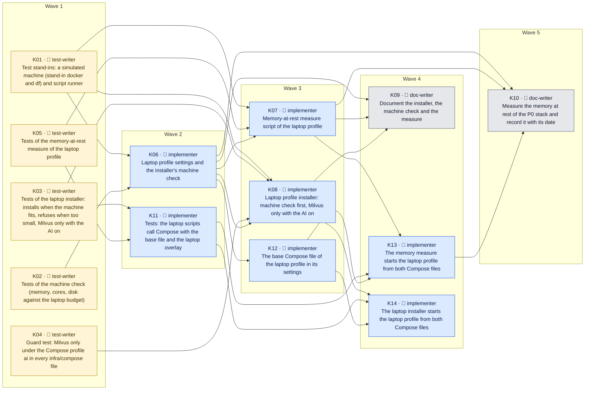

# T0.25: Plan

**Plan:** 🟢 Approved

**Push:** 🟢 Approved

<!-- ticket:specs -->
## 📚 Specifications

The specification and design pages of [TICKET.md](TICKET.md), copied by `python3 .claude/scripts/tickets/ticket_refs.py sync`.

- [REQ-T09-03](../../specs/03-technical/t09-install-backups-and-updates/requirements/req-t09-03-laptop-profile.md)
- [Performance and capacity](../../technical/infrastructure/performance-and-capacity.md)
- [REQ-T08-01](../../specs/03-technical/t08-rag-platform/requirements/req-t08-01-milvus-collections.md)
- [D22](../../specs/06-decisions/foundations/d22-no-graphics-card-needed.md)
- [📜 D408: Performance targets and resource profiles](../../specs/06-decisions/technical/d408-performance-and-profiles.md)
- [📌 REQ-T09-02: Compose and Helm everywhere](../../specs/03-technical/t09-install-backups-and-updates/requirements/req-t09-02-compose-and-helm.md)
- [📦 Installation](../../specs/05-non-functional/installation.md)
<!-- /ticket:specs -->

## Summary

T0.25 delivers three bash scripts in `infra/compose/`: the installer's machine check (memory, cores and free disk compared with the laptop budget), the laptop-profile installer, and a measure of memory at rest. All three read one settings file. The installer can start Milvus only through the Compose profile `ai`, and only when `--ai on` is given. Measured memory at rest is recorded with its date in the Performance and capacity page.

Wave 1 has five test-writer tasks under `tests/infra/compose/`: shared stand-ins that simulate a machine (a fake `docker` and `df` on PATH), tests for the check, the installer, the Milvus guard and the measure. Wave 2 writes the settings file and the check (K06). Wave 3 writes the installer (K08) and the measure script (K07); both read K06's settings file. Wave 4 has two doc-writer tasks. K10 runs the scripts on the machine and records the real numbers. K09 documents the scripts in `infra/compose/README.md` and the Today section of the infrastructure page.

The ticket changes no front end and lists no screen, so there is no Playwright task. No task changes `docs/specs/` or T0.21's Compose files.

## Assumptions

- No threshold for cores and disk is stated in the specifications (only 8 GB RAM and 4 cores at normal load in the design page); the plan must record the thresholds as assumptions.
- The roadmap has no per-ticket anchor, so the ticket link uses `#s04` and the epic link uses `#epics`.
- The Budgets touched page is Installation (laptop profile within 8 GB); Performance was not linked because T0.25 gives no latency measure.
- `check_ticket.py` was not run by this agent; the workflow runs it next.
- The machine check's minimums are 8192 MiB of memory (the 8 GB budget of D408), 4 cores (the "4 cores at normal load" of the Performance and capacity page) and 20 GiB of free disk. The specifications give no disk size, so the 20 GiB value is a plan choice. All three sit in `infra/compose/laptop-profile.env`, so they can be changed without touching code. Memory is compared with the total that Docker reports, so a laptop sold as 8 GB that reports less is refused (the cautious reading).
- The machine is read through `docker info` (memory, cores, Docker's data folder) and `df`. With Docker Desktop, that gives the memory and cores Docker can actually use. The simulated machine of the acceptance criteria is a stand-in `docker` and `df` placed first on PATH, following the stand-in `gh` pattern of `tests/ci/release`, with no mocks.
- The installer, the check and the measure are bash scripts in `infra/compose/`, because they run before anything of SimpleERP is installed. AGENT.md's Python rules do not apply to them. Their tests are pytest tests in `tests/infra/compose/`, which follow the `tests/conventions` rules.
- Exit codes: 0 when the machine fits or the profile is installed, 1 when the machine is too small or the profile did not start, 2 when Docker is missing or not running (the machine cannot be checked), and 64 for a bad argument.
- The laptop profile is the Compose file T0.21 delivers in `infra/compose/`. Its name is recorded once, as `LAPTOP_COMPOSE_FILE` in `laptop-profile.env`. No task of this plan changes T0.21's files.
- The P0 stack of T0.21 (platform, backoffice, PostgreSQL) has no Milvus, so this ticket adds no Milvus service. Milvus is expected to come with the AI service in P2 (T2.09). This ticket makes the Compose profile `ai` the only way Milvus can start. The installer passes `--profile ai` only with `--ai on`, and the AI is off by default in P0 because no AI service exists yet. A guard test over every Compose file of `infra/compose` keeps it that way for later tickets. The machine minimums are the same with the AI on, because the design page counts Milvus inside the 8 GB budget.
- "At rest" means 60 s after `docker compose up --wait` reports every service healthy, with no request and the AI off. It is the sum of the containers' memory from `docker stats --no-stream`. The measure is taken on the machine that runs the ticket, the owner's laptop that D408 names as the reference. If Docker cannot start the stack there, no number is written and the person runs the measure (TKT-8).
- Follow-up, not built here: CI's change detection (`.github/scripts/detect_changes.py`) runs the repository tests only for changes under `tests/`, `.claude/`, `.githooks/` and `.github/`. A change to the `infra/compose` scripts alone would therefore not run their tests in CI. Fixing that touches `.github`, which is outside this ticket's area (`infra/compose`), so it is left as a follow-up.

<!-- plan:graph -->

> [!NOTE]
> Generated from the json block at the end of this page by `python3 .claude/scripts/tickets/plan.py render`.
> To change a task, edit the json block, then render again: never edit this view by hand.

## Waves

| Wave | Tasks | Agents running at once |
| --- | --- | --- |
| 1 | [K01](#k01), [K02](#k02), [K03](#k03), [K04](#k04), [K05](#k05) | 5 of 5 |
| 2 | [K06](#k06), [K11](#k11) | 2 of 2 |
| 3 | [K07](#k07), [K08](#k08), [K12](#k12) | 3 of 3 |
| 4 | [K09](#k09), [K13](#k13), [K14](#k14) | 3 of 3 |
| 5 | [K10](#k10) | 1 of 1 |

| Wave | Task | Agent | Depends on | Unblocks |
| --- | --- | --- | --- | --- |
| 1 | [K01](#k01) Test stand-ins: a simulated machine (stand-in docker and df) and script runner | 🧪 test-writer | none | [K06](#k06), [K07](#k07), [K08](#k08) |
| 1 | [K02](#k02) Tests of the machine check (memory, cores, disk against the laptop budget) | 🧪 test-writer | none | [K06](#k06) |
| 1 | [K03](#k03) Tests of the laptop installer: installs when the machine fits, refuses when too small, Milvus only with the AI on | 🧪 test-writer | none | [K08](#k08), [K11](#k11) |
| 1 | [K04](#k04) Guard test: Milvus only under the Compose profile ai in every infra/compose file | 🧪 test-writer | none | [K08](#k08) |
| 1 | [K05](#k05) Tests of the memory-at-rest measure of the laptop profile | 🧪 test-writer | none | [K07](#k07), [K11](#k11) |
| 2 | [K06](#k06) Laptop profile settings and the installer's machine check | 🐍 implementer | [K01](#k01), [K02](#k02) | [K07](#k07), [K08](#k08), [K09](#k09), [K10](#k10), [K12](#k12) |
| 3 | [K07](#k07) Memory-at-rest measure script of the laptop profile | 🐍 implementer | [K01](#k01), [K05](#k05), [K06](#k06) | [K09](#k09), [K10](#k10), [K13](#k13) |
| 3 | [K08](#k08) Laptop profile installer: machine check first, Milvus only with the AI on | 🐍 implementer | [K01](#k01), [K03](#k03), [K04](#k04), [K06](#k06) | [K09](#k09), [K14](#k14) |
| 4 | [K09](#k09) Document the installer, the machine check and the measure | 📝 doc-writer | [K06](#k06), [K07](#k07), [K08](#k08) | none |
| 5 | [K10](#k10) Measure the memory at rest of the P0 stack and record it with its date | 📝 doc-writer | [K06](#k06), [K07](#k07), [K13](#k13) | none |
| 2 | [K11](#k11) Tests: the laptop scripts call Compose with the base file and the laptop overlay | 🐍 implementer | [K03](#k03), [K05](#k05) | [K13](#k13), [K14](#k14) |
| 3 | [K12](#k12) The base Compose file of the laptop profile in its settings | 🐍 implementer | [K06](#k06) | [K13](#k13), [K14](#k14) |
| 4 | [K13](#k13) The memory measure starts the laptop profile from both Compose files | 🐍 implementer | [K07](#k07), [K11](#k11), [K12](#k12) | [K10](#k10) |
| 4 | [K14](#k14) The laptop installer starts the laptop profile from both Compose files | 🐍 implementer | [K08](#k08), [K11](#k11), [K12](#k12) | none |

## Dependency graph



## Tasks

### <a id="k01"></a>K01: Test stand-ins: a simulated machine (stand-in docker and df) and script runner

| Agent | Wave | Depends on | Unblocks |
| --- | --- | --- | --- |
| 🧪 test-writer | 1 | none | [K06](#k06), [K07](#k07), [K08](#k08) |

**Files** (only this task may change them in its wave):

- `tests/infra/compose/helpers.py`

**Done when:** `uv run ruff check tests/infra/compose/helpers.py` and `uv run ruff format --check tests/infra/compose/helpers.py` pass; `uv run python -c "import tests.infra.compose.helpers as h; print(h.COMPOSE_DIR)"` prints the infra/compose path; `uv run pytest tests/conventions -n 2` passes.

**Brief:**

Write the shared test helpers that simulate a machine for the infra/compose scripts of T0.25, so that the acceptance criteria of REQ-T09-03 can be checked "with a simulated machine" (TICKET.md, criteria 1 and 2).

Specification: REQ-T09-03 (docs/specs/03-technical/t09-install-backups-and-updates/requirements/req-t09-03-laptop-profile.md), D408 (docs/specs/06-decisions/technical/d408-performance-and-profiles.md), D438 layout (docs/specs/06-decisions/technical/d438-repository-layout.md). Rules: AGENT.md "Tests" and "Rules a test enforces" (tests/conventions/ scans tests/: no class here, no nested function, at most five Python files per folder). Use the stand-in pattern of tests/ci/release/helpers.py (a stand-in executable answering from scenario.json and logging every call). Do not use unittest.mock.

Create tests/infra/compose/helpers.py with exactly this API (other test tasks of this wave import it by this path: `from tests.infra.compose.helpers import ...`):
- `ROOT: Path` = the repository root (`Path(__file__).resolve().parents[3]`); `COMPOSE_DIR: Path` = `ROOT / "infra" / "compose"`; `MIB: int = 1048576`.
- `STAND_IN_DOCKER: str` and `STAND_IN_DF: str`: the source of two `#!/usr/bin/env python3` stand-ins that read `scenario.json` next to themselves and append `{"argv": [...]}` per call to `calls.jsonl` next to themselves (df logs too, with `"tool": "df"`; docker with `"tool": "docker"`). The stand-in docker answers: `info ...` prints `<memory_bytes> <cpus> <docker_root>` and exits 0, or prints `Cannot connect to the Docker daemon.` on stderr and exits 1 when `docker_running` is false; `compose ... up ...` exits `up_exit`; `compose ... down ...` exits 0; `compose ... ps --quiet` prints one id per stats entry (`id-<name>`), sorted by name; `stats ...` prints `<name>\t<usage>` per stats entry, sorted by name; anything else exits 0. The stand-in df prints `Filesystem 1024-blocks Used Available Capacity Mounted on` then `/dev/sim 0 0 <disk_free_kib> 0% /`.
- `def profile_settings() -> Dict[str, str]`: parse `COMPOSE_DIR / "laptop-profile.env"` (lines `KEY=VALUE`, ignoring blank lines and `#` comments, stripping quotes).
- `def stand_in_machine(folder: Path, memory_mib: int = 16384, cpus: int = 12, disk_free_gib: int = 200, docker_running: bool = True, up_exit: int = 0, stats: Optional[Dict[str, str]] = None) -> Dict[str, str]`: create `folder/bin/docker`, `folder/bin/df` (mode 0o755), `folder/bin/scenario.json` (memory bytes = memory_mib * MIB, disk_free_kib = disk_free_gib * 1048576, docker_root = `folder/docker-root`, created), and return a copy of `os.environ` whose `PATH` starts with `folder/bin`.
- `def docker_calls(folder: Path) -> List[List[str]]`: the argv of every docker call, in order, from `folder/bin/calls.jsonl` (empty list when the file does not exist).
- `def run_script(name: str, args: List[str], env: Dict[str, str]) -> subprocess.CompletedProcess[str]`: run `["bash", str(COMPOSE_DIR / name), *args]` with `capture_output=True`, `text=True`, `timeout=60`, `cwd=ROOT`.

The scripts do not exist yet (tests first, TKT-4): do not create anything under infra/.

### <a id="k02"></a>K02: Tests of the machine check (memory, cores, disk against the laptop budget)

| Agent | Wave | Depends on | Unblocks |
| --- | --- | --- | --- |
| 🧪 test-writer | 1 | none | [K06](#k06) |

**Files** (only this task may change them in its wave):

- `tests/infra/compose/check_machine/test_check_machine.py`

**Done when:** `uv run ruff check tests/infra/compose/check_machine` and `uv run ruff format --check tests/infra/compose/check_machine` pass; `uv run pytest tests/infra/compose/check_machine --collect-only -q` lists the tests (they fail until K06 lands).

**Brief:**

Write the tests of `infra/compose/check-machine.sh`, the installer's machine check of REQ-T09-03 (docs/specs/03-technical/t09-install-backups-and-updates/requirements/req-t09-03-laptop-profile.md): "the installer checks the machine" against the 8 GB budget of D408 (docs/specs/06-decisions/technical/d408-performance-and-profiles.md) and the "4 cores at normal load" of the design page docs/technical/infrastructure/performance-and-capacity.md. Acceptance criteria 1 and 2 of REQ-T09-03 are checked with a simulated machine (TICKET.md).

Use the helpers of K01 (same wave, so the file is not there yet; import exactly): `from tests.infra.compose.helpers import MIB, profile_settings, run_script, stand_in_machine`. `stand_in_machine(tmp_path, memory_mib=..., cpus=..., disk_free_gib=..., docker_running=...)` returns the env; `run_script("check-machine.sh", [], env)` runs the script.

Contract of the script (no argument). Settings in `infra/compose/laptop-profile.env`: `MEMORY_MIN_MIB=8192`, `CPUS_MIN=4`, `DISK_FREE_MIN_GIB=20`. It reads `docker info --format '{{.MemTotal}} {{.NCPU}} {{.DockerRootDir}}'` and `df -Pk <DockerRootDir>`. Memory MiB = bytes // 1048576, free GiB = KiB // 1048576. Every value at or above its minimum: exit 0, stdout `The machine fits the laptop profile: <m> MiB of memory, <c> cores, <d> GiB of free disk.` Otherwise exit 1, stderr one line per shortfall: `Not enough memory: <m> MiB. The laptop profile needs at least <min> MiB.` / `Not enough cores: <c>. The laptop profile needs at least <min>.` / `Not enough free disk: <d> GiB. The laptop profile needs at least <min> GiB.`, then `This machine is too small for the laptop profile.` `docker info` failing: exit 2, stderr `Cannot check the machine: Docker is not installed or not running.`

One class `TestCheckMachine` in tests/infra/compose/check_machine/test_check_machine.py, tests named as sentences (AGENT.md "Tests"), `pytest.mark.parametrize` for the cases of one behaviour:
- the settings hold the budget: `profile_settings()` gives MEMORY_MIN_MIB 8192, CPUS_MIN 4, DISK_FREE_MIN_GIB 20;
- a machine above the budget (defaults) fits: exit 0, stdout says it fits with its three values;
- a machine exactly at every minimum fits (read the minimums from `profile_settings()`);
- one value one unit below its minimum (memory, cores, disk, parametrized) is too small: exit 1, stderr names that shortfall with the found value and the minimum, and says the machine is too small, and does not name the two other values;
- a machine short on all three lists the three shortfalls;
- Docker not running: exit 2 with the cannot-check message.
No file under infra/ is created by this task.

### <a id="k03"></a>K03: Tests of the laptop installer: installs when the machine fits, refuses when too small, Milvus only with the AI on

| Agent | Wave | Depends on | Unblocks |
| --- | --- | --- | --- |
| 🧪 test-writer | 1 | none | [K08](#k08), [K11](#k11) |

**Files** (only this task may change them in its wave):

- `tests/infra/compose/install/test_install.py`

**Done when:** `uv run ruff check tests/infra/compose/install` and `uv run ruff format --check tests/infra/compose/install` pass; `uv run pytest tests/infra/compose/install --collect-only -q` lists the tests (they fail until K08 lands).

**Brief:**

Write the tests of `infra/compose/install.sh`, the laptop-profile installer. They cover REQ-T09-03 (docs/specs/03-technical/t09-install-backups-and-updates/requirements/req-t09-03-laptop-profile.md) criterion 1 ("Given a laptop under the budget, it installs") and criterion 2 ("Given a machine too small, the installer says so"), with a simulated machine. They also cover TICKET.md criterion 4: with the AI off, the laptop profile starts without Milvus (REQ-T08-01 docs/specs/03-technical/t08-rag-platform/requirements/req-t08-01-milvus-collections.md, D22 docs/specs/06-decisions/foundations/d22-no-graphics-card-needed.md). The profile is the Compose profile of T0.21 (REQ-T09-02 docs/specs/03-technical/t09-install-backups-and-updates/requirements/req-t09-02-compose-and-helm.md).

Use the helpers of K01 (same wave; import exactly): `from tests.infra.compose.helpers import COMPOSE_DIR, docker_calls, profile_settings, run_script, stand_in_machine`. `stand_in_machine(tmp_path, memory_mib=..., docker_running=..., up_exit=...)` returns the env, `docker_calls(tmp_path)` the argv of every docker call.

Contract: `install.sh [--ai on|off]` (default off). It runs `check-machine.sh` from its own folder. When that exits non-zero, it exits with the same code, its messages are shown, and it never calls `docker compose`. Otherwise it runs `docker compose -f <COMPOSE_DIR / LAPTOP_COMPOSE_FILE> [--profile ai] up --detach --wait`, with `--profile ai` only with `--ai on`. It prints `Installed the laptop profile with the AI on.` or `... AI off.` and exits 0. When `up` fails, stderr has `The laptop profile did not start.` and it exits with compose's code. Any other argument: usage on stderr, exit 64. `LAPTOP_COMPOSE_FILE` is in `infra/compose/laptop-profile.env`, read with `profile_settings()`.

One class `TestInstall` in tests/infra/compose/install/test_install.py, with tests named as sentences:
- a machine under the budget installs: exit 0, exactly one `compose ... up` call whose `-f` value is the resolved path of `COMPOSE_DIR / LAPTOP_COMPOSE_FILE`, which exists, with `--detach` and `--wait`;
- with no flag and with `--ai off` (parametrize), the call has no `--profile ai`, so Milvus is not installed;
- with `--ai on` the call has `--profile ai`;
- a machine too small (memory_mib 4096) is told so: exit 1, stderr says it is too small, no `compose` call at all;
- Docker not running: exit 2, no `compose` call;
- a profile that does not start (up_exit 1): non-zero exit, the did-not-start message;
- a bad argument (`--ai maybe`, `--unknown`, parametrize): exit 64, no docker call.
AGENT.md "Tests" applies. Do not use unittest.mock. Create nothing under infra/.

### <a id="k04"></a>K04: Guard test: Milvus only under the Compose profile ai in every infra/compose file

| Agent | Wave | Depends on | Unblocks |
| --- | --- | --- | --- |
| 🧪 test-writer | 1 | none | [K08](#k08) |

**Files** (only this task may change them in its wave):

- `tests/infra/compose/milvus/test_milvus_profile.py`

**Done when:** `uv run ruff check tests/infra/compose/milvus` and `uv run ruff format --check tests/infra/compose/milvus` pass; `uv run pytest tests/infra/compose/milvus --collect-only -q` lists the two tests.

**Brief:**

Write a guard test so that Milvus can never start with the AI off. REQ-T08-01 (docs/specs/03-technical/t08-rag-platform/requirements/req-t08-01-milvus-collections.md) says "with the AI turned off it is optional and not installed". D22 (docs/specs/06-decisions/foundations/d22-no-graphics-card-needed.md) says "with the AI turned off, Milvus is not needed". REQ-T09-03 (docs/specs/03-technical/t09-install-backups-and-updates/requirements/req-t09-03-laptop-profile.md) applies too. Together they are TICKET.md criterion 4. The guard covers every Compose profile of infra/compose (laptop and one-server, from T0.21, REQ-T09-02 docs/specs/03-technical/t09-install-backups-and-updates/requirements/req-t09-02-compose-and-helm.md).

Import `from tests.infra.compose.helpers import COMPOSE_DIR, profile_settings` (K01, same wave). Parse with `yaml.safe_load` (pyyaml is a dev dependency of the root pyproject.toml), opening files with `encoding="utf-8"`.

One class `TestMilvusProfile` in tests/infra/compose/milvus/test_milvus_profile.py, with tests named as sentences:
- the folder holds Compose files: at least one `*.yaml` or `*.yml` under COMPOSE_DIR (recursive) has a `services` mapping, and the laptop profile file `COMPOSE_DIR / profile_settings()["LAPTOP_COMPOSE_FILE"]` is one of them (so the guard is never vacuous);
- every service of every Compose file whose name or `image` contains `milvus` (case-insensitive) lists `ai` in its `profiles`, so that without `--profile ai` Compose does not start it; the failure message names the file and the service.
The P0 stack of T0.21 has no Milvus service, so the second test passes as soon as the files exist. It guards every later ticket. Do not change any file under infra/. AGENT.md "Tests" applies.

### <a id="k05"></a>K05: Tests of the memory-at-rest measure of the laptop profile

| Agent | Wave | Depends on | Unblocks |
| --- | --- | --- | --- |
| 🧪 test-writer | 1 | none | [K07](#k07), [K11](#k11) |

**Files** (only this task may change them in its wave):

- `tests/infra/compose/measure_memory/test_measure_memory.py`

**Done when:** `uv run ruff check tests/infra/compose/measure_memory` and `uv run ruff format --check tests/infra/compose/measure_memory` pass; `uv run pytest tests/infra/compose/measure_memory --collect-only -q` lists the tests (they fail until K07 lands).

**Brief:**

Write the tests of `infra/compose/measure-memory.sh`. The script measures the memory at rest of the P0 stack on the laptop profile (REQ-T09-03 docs/specs/03-technical/t09-install-backups-and-updates/requirements/req-t09-03-laptop-profile.md, "Measure: Memory at rest"; D408 docs/specs/06-decisions/technical/d408-performance-and-profiles.md, "proved by a measured prototype"). Its dated output is recorded in docs/technical/infrastructure/performance-and-capacity.md (TICKET.md criterion 3). The measure runs with the AI off, so without Milvus (REQ-T08-01 docs/specs/03-technical/t08-rag-platform/requirements/req-t08-01-milvus-collections.md, D22 docs/specs/06-decisions/foundations/d22-no-graphics-card-needed.md).

Use the helpers of K01 (same wave; import exactly): `from tests.infra.compose.helpers import COMPOSE_DIR, docker_calls, profile_settings, run_script, stand_in_machine`. Use `stand_in_machine(tmp_path, stats={...}, up_exit=...)`, then `run_script("measure-memory.sh", ["--rest-s", "0"], env)`.

Contract: `measure-memory.sh [--rest-s N]` (default `REST_S` of `infra/compose/laptop-profile.env`, 60). It runs `docker compose -f <COMPOSE_DIR / LAPTOP_COMPOSE_FILE> up --detach --wait`, never with `--profile ai`, then sleeps N seconds. It runs `docker compose -f <file> ps --quiet`, then `docker stats --no-stream --format '{{.Name}}\t{{.MemUsage}}' <ids...>`. It converts the usage before ` / ` (units B, KiB, MiB, GiB) to MiB. It prints `Memory at rest of the laptop profile on <YYYY-MM-DD, UTC>, <N> s after start, AI off:`, then one line `<name>: <x.y> MiB` per container sorted by name, then `Total: <x.y> MiB` (one decimal). It always runs `docker compose -f <file> down` before exiting. When `up` fails, stderr has `The laptop profile did not start.`, it exits with compose's code and makes no stats call. Any other argument: exit 64.

One class `TestMeasureMemory` in tests/infra/compose/measure_memory/test_measure_memory.py, with tests named as sentences:
- three containers (`backoffice` `20.5MiB / 15.5GiB`, `platform` `300MiB / 15.5GiB`, `postgres` `1.5GiB / 15.5GiB`) give their lines and `Total: 1856.5 MiB`, and the header carries today's UTC date (`datetime.now(timezone.utc).date().isoformat()`) and `AI off`;
- units are converted (parametrize: `512KiB` gives 0.5, `1048576B` gives 1.0, `2GiB` gives 2048.0, `12.3MiB` gives 12.3);
- the calls come in order up, ps, stats, down; `up` uses `-f` with the laptop file and `--detach --wait`, and no call has `--profile ai`;
- a stack that does not start (up_exit 1) gives a non-zero exit and the did-not-start message, makes no `stats` call and still calls `down`;
- a bad argument gives exit 64.
AGENT.md "Tests" applies. Do not use unittest.mock. Create nothing under infra/.

### <a id="k06"></a>K06: Laptop profile settings and the installer's machine check

| Agent | Wave | Depends on | Unblocks |
| --- | --- | --- | --- |
| 🐍 implementer | 2 | [K01](#k01), [K02](#k02) | [K07](#k07), [K08](#k08), [K09](#k09), [K10](#k10), [K12](#k12) |

**Files** (only this task may change them in its wave):

- `infra/compose/laptop-profile.env`
- `infra/compose/check-machine.sh`

**Done when:** `bash -n infra/compose/check-machine.sh` passes, the file is executable, and `uv run pytest tests/infra/compose/check_machine -n 2` passes.

**Brief:**

Build the installer's machine check of REQ-T09-03 (docs/specs/03-technical/t09-install-backups-and-updates/requirements/req-t09-03-laptop-profile.md): "the installer checks the machine" (memory, cores, disk) against the 8 GB laptop budget of D408 (docs/specs/06-decisions/technical/d408-performance-and-profiles.md) and the "4 cores at normal load" of docs/technical/infrastructure/performance-and-capacity.md. It lives in infra/compose (D438, docs/specs/06-decisions/technical/d438-repository-layout.md), beside the Compose profiles of T0.21 (REQ-T09-02 docs/specs/03-technical/t09-install-backups-and-updates/requirements/req-t09-02-compose-and-helm.md).

1. `infra/compose/laptop-profile.env`: the data the scripts read, never hard-coded in them. It has one `# ` comment per value giving its source, and exactly these keys: `MEMORY_MIN_MIB=8192` (the 8 GB budget, D408), `CPUS_MIN=4` (the design page), `DISK_FREE_MIN_GIB=20` (a plan assumption: the specifications give no disk size, so say so in the comment), `REST_S=60` (seconds of rest before the memory measure), and `LAPTOP_COMPOSE_FILE=<the Compose file of the laptop profile that T0.21 delivered, relative to infra/compose/>`. Read infra/compose/ to find that file. Do not change T0.21's files.
2. `infra/compose/check-machine.sh`, bash (`#!/usr/bin/env bash`, `set -euo pipefail`, executable bit set, a header comment saying what it does). It sources laptop-profile.env from its own folder (`$(dirname "${BASH_SOURCE[0]}")`) and takes no argument. It reads `docker info --format '{{.MemTotal}} {{.NCPU}} {{.DockerRootDir}}'` (bytes, cores, folder) and `df -Pk <DockerRootDir>` (the script's folder when that folder does not exist). The available KiB is the 4th column of the 2nd line. Memory MiB = bytes / 1048576 and free GiB = KiB / 1048576, both rounded down. When every value is at or above its minimum: exit 0, stdout `The machine fits the laptop profile: <m> MiB of memory, <c> cores, <d> GiB of free disk.` Otherwise: exit 1, stderr one line per shortfall, in this order: `Not enough memory: <m> MiB. The laptop profile needs at least <min> MiB.`, `Not enough cores: <c>. The laptop profile needs at least <min>.`, `Not enough free disk: <d> GiB. The laptop profile needs at least <min> GiB.`, then `This machine is too small for the laptop profile.` When docker is missing or `docker info` fails: exit 2, stderr `Cannot check the machine: Docker is not installed or not running.`

Messages are plain British English full sentences, with no em dash (AGENT.md "Messages", "Formatting and prose"). AGENT.md's Python rules do not apply to shell. Run shellcheck if it is installed. The tests of K02 (tests/infra/compose/check_machine/) and the helpers of K01 are the contract. If one of them is wrong, report it as blocked (TKT-19) rather than working around it.

### <a id="k07"></a>K07: Memory-at-rest measure script of the laptop profile

| Agent | Wave | Depends on | Unblocks |
| --- | --- | --- | --- |
| 🐍 implementer | 3 | [K01](#k01), [K05](#k05), [K06](#k06) | [K09](#k09), [K10](#k10), [K13](#k13) |

**Files** (only this task may change them in its wave):

- `infra/compose/measure-memory.sh`

**Done when:** `bash -n infra/compose/measure-memory.sh` passes, the file is executable, and `uv run pytest tests/infra/compose/measure_memory -n 2` passes.

**Brief:**

Build `infra/compose/measure-memory.sh`. It measures the memory at rest of the P0 stack on the laptop profile (REQ-T09-03 docs/specs/03-technical/t09-install-backups-and-updates/requirements/req-t09-03-laptop-profile.md, "Measure: Memory at rest"; D408 docs/specs/06-decisions/technical/d408-performance-and-profiles.md, "proved by a measured prototype before it is promised"). Its output is recorded in docs/technical/infrastructure/performance-and-capacity.md by K10. It always measures with the AI off, so without Milvus (REQ-T08-01 docs/specs/03-technical/t08-rag-platform/requirements/req-t08-01-milvus-collections.md, D22 docs/specs/06-decisions/foundations/d22-no-graphics-card-needed.md). The laptop profile is T0.21's (REQ-T09-02 docs/specs/03-technical/t09-install-backups-and-updates/requirements/req-t09-02-compose-and-helm.md).

Write it in bash (`#!/usr/bin/env bash`, `set -euo pipefail`, executable, header comment). It sources `laptop-profile.env` (K06) from its own folder and uses `LAPTOP_COMPOSE_FILE` resolved against that folder, and `REST_S`. Usage: `measure-memory.sh [--rest-s N]`; any other argument prints usage on stderr and exits 64. Steps:
1. `docker compose -f <file> up --detach --wait`, never with `--profile ai`. If it fails: stderr `The laptop profile did not start.`, exit with its code.
2. `sleep N`.
3. `docker compose -f <file> ps --quiet`, then `docker stats --no-stream --format '{{.Name}}\t{{.MemUsage}}' <ids...>`.
4. Convert the usage before ` / ` to MiB, with units B, KiB, MiB and GiB (awk is fine).
5. Print `Memory at rest of the laptop profile on <date -u +%F>, <N> s after start, AI off:`, one line `<name>: <x.y> MiB` per container sorted by name, then `Total: <x.y> MiB`, one decimal each.
A trap always runs `docker compose -f <file> down` before exit, including after a failed `up`. Messages are plain British English, with no em dash. The tests of K05 (tests/infra/compose/measure_memory/) and the helpers of K01 are the contract. If one is wrong, report blocked (TKT-19).

### <a id="k08"></a>K08: Laptop profile installer: machine check first, Milvus only with the AI on

| Agent | Wave | Depends on | Unblocks |
| --- | --- | --- | --- |
| 🐍 implementer | 3 | [K01](#k01), [K03](#k03), [K04](#k04), [K06](#k06) | [K09](#k09), [K14](#k14) |

**Files** (only this task may change them in its wave):

- `infra/compose/install.sh`

**Done when:** `bash -n infra/compose/install.sh` passes, the file is executable, and `uv run pytest tests/infra/compose/install -n 2` and `uv run pytest tests/infra/compose/milvus -n 2` pass.

**Brief:**

Build `infra/compose/install.sh`, the installer of the laptop profile. It checks the machine first and installs only when the machine fits (REQ-T09-03 docs/specs/03-technical/t09-install-backups-and-updates/requirements/req-t09-03-laptop-profile.md criteria 1 and 2; D408 docs/specs/06-decisions/technical/d408-performance-and-profiles.md). With the AI off it leaves Milvus out (REQ-T08-01 docs/specs/03-technical/t08-rag-platform/requirements/req-t08-01-milvus-collections.md; D22 docs/specs/06-decisions/foundations/d22-no-graphics-card-needed.md; installation budget docs/specs/05-non-functional/installation.md). It starts T0.21's laptop profile from the same images (REQ-T09-02 docs/specs/03-technical/t09-install-backups-and-updates/requirements/req-t09-02-compose-and-helm.md).

Write it in bash (`#!/usr/bin/env bash`, `set -euo pipefail`, executable, header comment). Usage: `install.sh [--ai on|off]`, default off. Any other argument, or a value other than on or off, prints usage on stderr and exits 64 before any docker call. Steps:
1. Run `check-machine.sh` (K06) from the script's own folder, letting its output through. If it exits non-zero, exit with the same code and never call `docker compose`.
2. Source `laptop-profile.env` from its own folder and run `docker compose -f <folder>/<LAPTOP_COMPOSE_FILE> [--profile ai] up --detach --wait`. Pass `--profile ai` only with `--ai on`: Compose then starts the services of the profile `ai` (Milvus, when a later ticket adds it) only then.
3. On success, print `Installed the laptop profile with the AI on.` or `Installed the laptop profile with the AI off.` and exit 0. On failure, print `The laptop profile did not start.` on stderr and exit with compose's code.
Do not change T0.21's Compose files. The guard test of K04 (tests/infra/compose/milvus/) must pass on them as they are. If it fails because a Compose file declares Milvus outside the profile `ai`, report it as blocked and name the file. Messages are plain British English, with no em dash. The tests of K03 (tests/infra/compose/install/), K04 and the helpers of K01 are the contract. If one is wrong, report blocked (TKT-19).

### <a id="k09"></a>K09: Document the installer, the machine check and the measure

| Agent | Wave | Depends on | Unblocks |
| --- | --- | --- | --- |
| 📝 doc-writer | 4 | [K06](#k06), [K07](#k07), [K08](#k08) | none |

**Files** (only this task may change them in its wave):

- `infra/compose/README.md`
- `docs/technical/infrastructure/infrastructure.md`

**Done when:** `grep -n 'install.sh' infra/compose/README.md` and `grep -n 'measure-memory.sh' infra/compose/README.md` find the new sections; the "Today" section of docs/technical/infrastructure/infrastructure.md names the installer's machine check; every relative link of both files resolves.

**Brief:**

Document what T0.25 built, from the scripts as they are. Read infra/compose/install.sh, check-machine.sh, measure-memory.sh and laptop-profile.env first, and write nothing they do not do.

Specification to cite: REQ-T09-03 (docs/specs/03-technical/t09-install-backups-and-updates/requirements/req-t09-03-laptop-profile.md), REQ-T08-01 (docs/specs/03-technical/t08-rag-platform/requirements/req-t08-01-milvus-collections.md), D408 (docs/specs/06-decisions/technical/d408-performance-and-profiles.md), D22 (docs/specs/06-decisions/foundations/d22-no-graphics-card-needed.md), REQ-T09-02 (docs/specs/03-technical/t09-install-backups-and-updates/requirements/req-t09-02-compose-and-helm.md). Do not change docs/specs/.

1. infra/compose/README.md (it exists from earlier P0 tickets; keep its content): add a section "Installing the laptop profile". It shows the command `infra/compose/install.sh [--ai on|off]`. It says that the installer checks the machine first, with `infra/compose/check-machine.sh` on its own. It gives the three minimums of laptop-profile.env and where each comes from: 8192 MiB from the 8 GB budget of D408, 4 cores from the design page, 20 GiB of free disk as an assumption of T0.25. It gives the exit codes (0 fits or installed, 1 too small or did not start, 2 Docker not running, 64 bad argument). It says that Milvus starts only with `--ai on`, through the Compose profile `ai` (REQ-T08-01, D22). Add a section "Measuring the memory at rest" for `infra/compose/measure-memory.sh [--rest-s N]` and what it prints. Say that the 8 GB promise waits for the whole stack in P2.
2. docs/technical/infrastructure/infrastructure.md: in its "Today" section, replace "Nothing built yet" with one or two sentences. They say that the laptop profile's installer checks the machine against the budget and leaves Milvus out with the AI off (T0.25, infra/compose/), with a relative link to ../../../infra/compose/README.md. Keep the target design as it is.
Write plain British English, with no em dash and no invented fact (TKT-8).

### <a id="k10"></a>K10: Measure the memory at rest of the P0 stack and record it with its date

| Agent | Wave | Depends on | Unblocks |
| --- | --- | --- | --- |
| 📝 doc-writer | 5 | [K06](#k06), [K07](#k07), [K13](#k13) | none |

**Files** (only this task may change them in its wave):

- `docs/technical/infrastructure/performance-and-capacity.md`
- `docs/tickets/T0.25/tests-evidences/memory-at-rest.txt`

**Done when:** docs/tickets/T0.25/tests-evidences/memory-at-rest.txt holds the outputs of both scripts; `grep -n 'Memory at rest' docs/technical/infrastructure/performance-and-capacity.md` finds the subsection; its table has a dated Total row whose value equals the `Total:` line of the evidence file.

**Brief:**

Record a real measure of the memory at rest of the P0 stack on the laptop profile, with its date, in docs/technical/infrastructure/performance-and-capacity.md (TICKET.md criterion 3). This follows REQ-T09-03 (docs/specs/03-technical/t09-install-backups-and-updates/requirements/req-t09-03-laptop-profile.md), "Measure: Memory at rest", and D408 (docs/specs/06-decisions/technical/d408-performance-and-profiles.md): the budget is "proved by a measured prototype before it is promised". It is measured with the AI off, so without Milvus (REQ-T08-01 docs/specs/03-technical/t08-rag-platform/requirements/req-t08-01-milvus-collections.md, D22 docs/specs/06-decisions/foundations/d22-no-graphics-card-needed.md). Do not change docs/specs/.

1. From the repository root, run `bash infra/compose/check-machine.sh`, then `bash infra/compose/measure-memory.sh`, which waits 60 s at rest. Write both commands and their full outputs to docs/tickets/T0.25/tests-evidences/memory-at-rest.txt.
2. In performance-and-capacity.md, replace "Nothing built yet." under "Today" with a subsection "Memory at rest of the laptop profile (measured)". It holds one sentence on the method: the P0 stack of the laptop profile with the AI off, 60 s after every service is healthy with no request, the memory of each container from `docker stats`, measured with `infra/compose/measure-memory.sh`. Then a table with the columns Date, Machine, Container, Memory at rest (MiB): one row per container and one Total row. Take the date from the script's output and the machine (memory, cores) from the check's output. Add one sentence saying that this is the P0 stack only, so the 8 GB promise waits for the whole stack in P2 (P0 risks, docs/specs/00-vision/roadmap/phases/01-p0-foundations.md#risks). Update the "Last reviewed" line to the measure's date, keeping its form.
3. Copy every number from the outputs. Never estimate one (TKT-8). If Docker is missing, the images are missing or the stack does not start here, write nothing in the page. Save the outputs as evidence, and report the task as blocked with the reason, so that the person runs the measure. The images of the P0 stack may be built here instead of pulled: from the repository root, `docker build -f backend/services/platform/Dockerfile -t simpleerp-local-platform:p0 .` and `docker build -f frontend/backoffice/Dockerfile -t simpleerp-local-backoffice:p0 .`, then run the measure with `ERP_IMAGE_PREFIX=simpleerp-local ERP_IMAGE_TAG=p0`. If infra/compose/secrets/postgres_password is missing, create it as compose.yaml's header says (`openssl rand -base64 24`); git ignores it. Write in the page that the images were built from the commit measured. When the measure is done, remove what you made (TKT-27): `docker compose ... down --volumes`, the two local images, and the secret file if you created it.

### <a id="k11"></a>K11: Tests: the laptop scripts call Compose with the base file and the laptop overlay

| Agent | Wave | Depends on | Unblocks |
| --- | --- | --- | --- |
| 🐍 implementer | 2 | [K03](#k03), [K05](#k05) | [K13](#k13), [K14](#k14) |

**Files** (only this task may change them in its wave):

- `tests/infra/compose/install/test_install.py`
- `tests/infra/compose/measure_memory/test_measure_memory.py`

**Done when:** `uv run --all-packages pytest tests/infra/compose -q` fails only on the scripts' compose calls (one -f) until K13 and K14 are integrated; ruff check and ruff format --check pass on both files.

**Brief:**

compose.laptop.yaml is an overlay laid over compose.yaml (its header, and T0.21's EXPLAIN.md): it only binds the ports to 127.0.0.1 and names no image. Passed alone with -f, Compose refuses the project: `service "platform" has neither an image nor a build context specified` (K10, twice). The laptop profile is `docker compose -f infra/compose/compose.yaml -f infra/compose/compose.laptop.yaml`, base first, overlay second. Change the assertions of these two test files that read the first `-f` value as the laptop file: every compose call of install.sh and measure-memory.sh must carry exactly two `-f` options, `<infra/compose>/compose.yaml` then `<infra/compose>/compose.laptop.yaml`, in that order. Change nothing else in the files.

### <a id="k12"></a>K12: The base Compose file of the laptop profile in its settings

| Agent | Wave | Depends on | Unblocks |
| --- | --- | --- | --- |
| 🐍 implementer | 3 | [K06](#k06) | [K13](#k13), [K14](#k14) |

**Files** (only this task may change them in its wave):

- `infra/compose/laptop-profile.env`

**Done when:** `grep -n '^BASE_COMPOSE_FILE=compose.yaml$' infra/compose/laptop-profile.env` finds the line; `uv run --all-packages pytest tests/infra/compose -q` has no failure about the settings.

**Brief:**

compose.laptop.yaml is an overlay laid over compose.yaml (its header, and T0.21's EXPLAIN.md): it only binds the ports to 127.0.0.1 and names no image. Passed alone with -f, Compose refuses the project: `service "platform" has neither an image nor a build context specified` (K10, twice). The laptop profile is `docker compose -f infra/compose/compose.yaml -f infra/compose/compose.laptop.yaml`, base first, overlay second. In infra/compose/laptop-profile.env, add `BASE_COMPOSE_FILE=compose.yaml` just above LAPTOP_COMPOSE_FILE, with a one-line comment: the Compose file of T0.21 that the laptop overlay is laid over, relative to infra/compose/. Change nothing else.

### <a id="k13"></a>K13: The memory measure starts the laptop profile from both Compose files

| Agent | Wave | Depends on | Unblocks |
| --- | --- | --- | --- |
| 🐍 implementer | 4 | [K07](#k07), [K11](#k11), [K12](#k12) | [K10](#k10) |

**Files** (only this task may change them in its wave):

- `infra/compose/measure-memory.sh`

**Done when:** `uv run --all-packages pytest tests/infra/compose -q` passes for the measure tests; `bash -n infra/compose/measure-memory.sh` exits 0.

**Brief:**

compose.laptop.yaml is an overlay laid over compose.yaml (its header, and T0.21's EXPLAIN.md): it only binds the ports to 127.0.0.1 and names no image. Passed alone with -f, Compose refuses the project: `service "platform" has neither an image nor a build context specified` (K10, twice). The laptop profile is `docker compose -f infra/compose/compose.yaml -f infra/compose/compose.laptop.yaml`, base first, overlay second. In infra/compose/measure-memory.sh, run every `docker compose` call (down, up, ps) with `-f "${HERE}/${BASE_COMPOSE_FILE}" -f "${HERE}/${LAPTOP_COMPOSE_FILE}"`, both read from laptop-profile.env. Change nothing else.

### <a id="k14"></a>K14: The laptop installer starts the laptop profile from both Compose files

| Agent | Wave | Depends on | Unblocks |
| --- | --- | --- | --- |
| 🐍 implementer | 4 | [K08](#k08), [K11](#k11), [K12](#k12) | none |

**Files** (only this task may change them in its wave):

- `infra/compose/install.sh`

**Done when:** `uv run --all-packages pytest tests/infra/compose -q` passes; `bash -n infra/compose/install.sh` exits 0.

**Brief:**

compose.laptop.yaml is an overlay laid over compose.yaml (its header, and T0.21's EXPLAIN.md): it only binds the ports to 127.0.0.1 and names no image. Passed alone with -f, Compose refuses the project: `service "platform" has neither an image nor a build context specified` (K10, twice). The laptop profile is `docker compose -f infra/compose/compose.yaml -f infra/compose/compose.laptop.yaml`, base first, overlay second. In infra/compose/install.sh, build the compose command as `docker compose -f "${HERE}/${BASE_COMPOSE_FILE}" -f "${HERE}/${LAPTOP_COMPOSE_FILE}"`, both read from laptop-profile.env. Change nothing else.

<!-- /plan:graph -->

## Task graph

<details>
<summary>🤖 Task graph as read by <code>/ticket-run</code> (json)</summary>

```json
[
  {
    "id": "K01",
    "title": "Test stand-ins: a simulated machine (stand-in docker and df) and script runner",
    "agent": "test-writer",
    "depends_on": [],
    "files": [
      "tests/infra/compose/helpers.py"
    ],
    "brief": "Write the shared test helpers that simulate a machine for the infra/compose scripts of T0.25, so that the acceptance criteria of REQ-T09-03 can be checked \"with a simulated machine\" (TICKET.md, criteria 1 and 2).\n\nSpecification: REQ-T09-03 (docs/specs/03-technical/t09-install-backups-and-updates/requirements/req-t09-03-laptop-profile.md), D408 (docs/specs/06-decisions/technical/d408-performance-and-profiles.md), D438 layout (docs/specs/06-decisions/technical/d438-repository-layout.md). Rules: AGENT.md \"Tests\" and \"Rules a test enforces\" (tests/conventions/ scans tests/: no class here, no nested function, at most five Python files per folder). Use the stand-in pattern of tests/ci/release/helpers.py (a stand-in executable answering from scenario.json and logging every call). Do not use unittest.mock.\n\nCreate tests/infra/compose/helpers.py with exactly this API (other test tasks of this wave import it by this path: `from tests.infra.compose.helpers import ...`):\n- `ROOT: Path` = the repository root (`Path(__file__).resolve().parents[3]`); `COMPOSE_DIR: Path` = `ROOT / \"infra\" / \"compose\"`; `MIB: int = 1048576`.\n- `STAND_IN_DOCKER: str` and `STAND_IN_DF: str`: the source of two `#!/usr/bin/env python3` stand-ins that read `scenario.json` next to themselves and append `{\"argv\": [...]}` per call to `calls.jsonl` next to themselves (df logs too, with `\"tool\": \"df\"`; docker with `\"tool\": \"docker\"`). The stand-in docker answers: `info ...` prints `<memory_bytes> <cpus> <docker_root>` and exits 0, or prints `Cannot connect to the Docker daemon.` on stderr and exits 1 when `docker_running` is false; `compose ... up ...` exits `up_exit`; `compose ... down ...` exits 0; `compose ... ps --quiet` prints one id per stats entry (`id-<name>`), sorted by name; `stats ...` prints `<name>\\t<usage>` per stats entry, sorted by name; anything else exits 0. The stand-in df prints `Filesystem 1024-blocks Used Available Capacity Mounted on` then `/dev/sim 0 0 <disk_free_kib> 0% /`.\n- `def profile_settings() -> Dict[str, str]`: parse `COMPOSE_DIR / \"laptop-profile.env\"` (lines `KEY=VALUE`, ignoring blank lines and `#` comments, stripping quotes).\n- `def stand_in_machine(folder: Path, memory_mib: int = 16384, cpus: int = 12, disk_free_gib: int = 200, docker_running: bool = True, up_exit: int = 0, stats: Optional[Dict[str, str]] = None) -> Dict[str, str]`: create `folder/bin/docker`, `folder/bin/df` (mode 0o755), `folder/bin/scenario.json` (memory bytes = memory_mib * MIB, disk_free_kib = disk_free_gib * 1048576, docker_root = `folder/docker-root`, created), and return a copy of `os.environ` whose `PATH` starts with `folder/bin`.\n- `def docker_calls(folder: Path) -> List[List[str]]`: the argv of every docker call, in order, from `folder/bin/calls.jsonl` (empty list when the file does not exist).\n- `def run_script(name: str, args: List[str], env: Dict[str, str]) -> subprocess.CompletedProcess[str]`: run `[\"bash\", str(COMPOSE_DIR / name), *args]` with `capture_output=True`, `text=True`, `timeout=60`, `cwd=ROOT`.\n\nThe scripts do not exist yet (tests first, TKT-4): do not create anything under infra/.",
    "done_when": "`uv run ruff check tests/infra/compose/helpers.py` and `uv run ruff format --check tests/infra/compose/helpers.py` pass; `uv run python -c \"import tests.infra.compose.helpers as h; print(h.COMPOSE_DIR)\"` prints the infra/compose path; `uv run pytest tests/conventions -n 2` passes.",
    "wave": 1
  },
  {
    "id": "K02",
    "title": "Tests of the machine check (memory, cores, disk against the laptop budget)",
    "agent": "test-writer",
    "depends_on": [],
    "files": [
      "tests/infra/compose/check_machine/test_check_machine.py"
    ],
    "brief": "Write the tests of `infra/compose/check-machine.sh`, the installer's machine check of REQ-T09-03 (docs/specs/03-technical/t09-install-backups-and-updates/requirements/req-t09-03-laptop-profile.md): \"the installer checks the machine\" against the 8 GB budget of D408 (docs/specs/06-decisions/technical/d408-performance-and-profiles.md) and the \"4 cores at normal load\" of the design page docs/technical/infrastructure/performance-and-capacity.md. Acceptance criteria 1 and 2 of REQ-T09-03 are checked with a simulated machine (TICKET.md).\n\nUse the helpers of K01 (same wave, so the file is not there yet; import exactly): `from tests.infra.compose.helpers import MIB, profile_settings, run_script, stand_in_machine`. `stand_in_machine(tmp_path, memory_mib=..., cpus=..., disk_free_gib=..., docker_running=...)` returns the env; `run_script(\"check-machine.sh\", [], env)` runs the script.\n\nContract of the script (no argument). Settings in `infra/compose/laptop-profile.env`: `MEMORY_MIN_MIB=8192`, `CPUS_MIN=4`, `DISK_FREE_MIN_GIB=20`. It reads `docker info --format '{{.MemTotal}} {{.NCPU}} {{.DockerRootDir}}'` and `df -Pk <DockerRootDir>`. Memory MiB = bytes // 1048576, free GiB = KiB // 1048576. Every value at or above its minimum: exit 0, stdout `The machine fits the laptop profile: <m> MiB of memory, <c> cores, <d> GiB of free disk.` Otherwise exit 1, stderr one line per shortfall: `Not enough memory: <m> MiB. The laptop profile needs at least <min> MiB.` / `Not enough cores: <c>. The laptop profile needs at least <min>.` / `Not enough free disk: <d> GiB. The laptop profile needs at least <min> GiB.`, then `This machine is too small for the laptop profile.` `docker info` failing: exit 2, stderr `Cannot check the machine: Docker is not installed or not running.`\n\nOne class `TestCheckMachine` in tests/infra/compose/check_machine/test_check_machine.py, tests named as sentences (AGENT.md \"Tests\"), `pytest.mark.parametrize` for the cases of one behaviour:\n- the settings hold the budget: `profile_settings()` gives MEMORY_MIN_MIB 8192, CPUS_MIN 4, DISK_FREE_MIN_GIB 20;\n- a machine above the budget (defaults) fits: exit 0, stdout says it fits with its three values;\n- a machine exactly at every minimum fits (read the minimums from `profile_settings()`);\n- one value one unit below its minimum (memory, cores, disk, parametrized) is too small: exit 1, stderr names that shortfall with the found value and the minimum, and says the machine is too small, and does not name the two other values;\n- a machine short on all three lists the three shortfalls;\n- Docker not running: exit 2 with the cannot-check message.\nNo file under infra/ is created by this task.",
    "done_when": "`uv run ruff check tests/infra/compose/check_machine` and `uv run ruff format --check tests/infra/compose/check_machine` pass; `uv run pytest tests/infra/compose/check_machine --collect-only -q` lists the tests (they fail until K06 lands).",
    "wave": 1
  },
  {
    "id": "K03",
    "title": "Tests of the laptop installer: installs when the machine fits, refuses when too small, Milvus only with the AI on",
    "agent": "test-writer",
    "depends_on": [],
    "files": [
      "tests/infra/compose/install/test_install.py"
    ],
    "brief": "Write the tests of `infra/compose/install.sh`, the laptop-profile installer. They cover REQ-T09-03 (docs/specs/03-technical/t09-install-backups-and-updates/requirements/req-t09-03-laptop-profile.md) criterion 1 (\"Given a laptop under the budget, it installs\") and criterion 2 (\"Given a machine too small, the installer says so\"), with a simulated machine. They also cover TICKET.md criterion 4: with the AI off, the laptop profile starts without Milvus (REQ-T08-01 docs/specs/03-technical/t08-rag-platform/requirements/req-t08-01-milvus-collections.md, D22 docs/specs/06-decisions/foundations/d22-no-graphics-card-needed.md). The profile is the Compose profile of T0.21 (REQ-T09-02 docs/specs/03-technical/t09-install-backups-and-updates/requirements/req-t09-02-compose-and-helm.md).\n\nUse the helpers of K01 (same wave; import exactly): `from tests.infra.compose.helpers import COMPOSE_DIR, docker_calls, profile_settings, run_script, stand_in_machine`. `stand_in_machine(tmp_path, memory_mib=..., docker_running=..., up_exit=...)` returns the env, `docker_calls(tmp_path)` the argv of every docker call.\n\nContract: `install.sh [--ai on|off]` (default off). It runs `check-machine.sh` from its own folder. When that exits non-zero, it exits with the same code, its messages are shown, and it never calls `docker compose`. Otherwise it runs `docker compose -f <COMPOSE_DIR / LAPTOP_COMPOSE_FILE> [--profile ai] up --detach --wait`, with `--profile ai` only with `--ai on`. It prints `Installed the laptop profile with the AI on.` or `... AI off.` and exits 0. When `up` fails, stderr has `The laptop profile did not start.` and it exits with compose's code. Any other argument: usage on stderr, exit 64. `LAPTOP_COMPOSE_FILE` is in `infra/compose/laptop-profile.env`, read with `profile_settings()`.\n\nOne class `TestInstall` in tests/infra/compose/install/test_install.py, with tests named as sentences:\n- a machine under the budget installs: exit 0, exactly one `compose ... up` call whose `-f` value is the resolved path of `COMPOSE_DIR / LAPTOP_COMPOSE_FILE`, which exists, with `--detach` and `--wait`;\n- with no flag and with `--ai off` (parametrize), the call has no `--profile ai`, so Milvus is not installed;\n- with `--ai on` the call has `--profile ai`;\n- a machine too small (memory_mib 4096) is told so: exit 1, stderr says it is too small, no `compose` call at all;\n- Docker not running: exit 2, no `compose` call;\n- a profile that does not start (up_exit 1): non-zero exit, the did-not-start message;\n- a bad argument (`--ai maybe`, `--unknown`, parametrize): exit 64, no docker call.\nAGENT.md \"Tests\" applies. Do not use unittest.mock. Create nothing under infra/.",
    "done_when": "`uv run ruff check tests/infra/compose/install` and `uv run ruff format --check tests/infra/compose/install` pass; `uv run pytest tests/infra/compose/install --collect-only -q` lists the tests (they fail until K08 lands).",
    "wave": 1
  },
  {
    "id": "K04",
    "title": "Guard test: Milvus only under the Compose profile ai in every infra/compose file",
    "agent": "test-writer",
    "depends_on": [],
    "files": [
      "tests/infra/compose/milvus/test_milvus_profile.py"
    ],
    "brief": "Write a guard test so that Milvus can never start with the AI off. REQ-T08-01 (docs/specs/03-technical/t08-rag-platform/requirements/req-t08-01-milvus-collections.md) says \"with the AI turned off it is optional and not installed\". D22 (docs/specs/06-decisions/foundations/d22-no-graphics-card-needed.md) says \"with the AI turned off, Milvus is not needed\". REQ-T09-03 (docs/specs/03-technical/t09-install-backups-and-updates/requirements/req-t09-03-laptop-profile.md) applies too. Together they are TICKET.md criterion 4. The guard covers every Compose profile of infra/compose (laptop and one-server, from T0.21, REQ-T09-02 docs/specs/03-technical/t09-install-backups-and-updates/requirements/req-t09-02-compose-and-helm.md).\n\nImport `from tests.infra.compose.helpers import COMPOSE_DIR, profile_settings` (K01, same wave). Parse with `yaml.safe_load` (pyyaml is a dev dependency of the root pyproject.toml), opening files with `encoding=\"utf-8\"`.\n\nOne class `TestMilvusProfile` in tests/infra/compose/milvus/test_milvus_profile.py, with tests named as sentences:\n- the folder holds Compose files: at least one `*.yaml` or `*.yml` under COMPOSE_DIR (recursive) has a `services` mapping, and the laptop profile file `COMPOSE_DIR / profile_settings()[\"LAPTOP_COMPOSE_FILE\"]` is one of them (so the guard is never vacuous);\n- every service of every Compose file whose name or `image` contains `milvus` (case-insensitive) lists `ai` in its `profiles`, so that without `--profile ai` Compose does not start it; the failure message names the file and the service.\nThe P0 stack of T0.21 has no Milvus service, so the second test passes as soon as the files exist. It guards every later ticket. Do not change any file under infra/. AGENT.md \"Tests\" applies.",
    "done_when": "`uv run ruff check tests/infra/compose/milvus` and `uv run ruff format --check tests/infra/compose/milvus` pass; `uv run pytest tests/infra/compose/milvus --collect-only -q` lists the two tests.",
    "wave": 1
  },
  {
    "id": "K05",
    "title": "Tests of the memory-at-rest measure of the laptop profile",
    "agent": "test-writer",
    "depends_on": [],
    "files": [
      "tests/infra/compose/measure_memory/test_measure_memory.py"
    ],
    "brief": "Write the tests of `infra/compose/measure-memory.sh`. The script measures the memory at rest of the P0 stack on the laptop profile (REQ-T09-03 docs/specs/03-technical/t09-install-backups-and-updates/requirements/req-t09-03-laptop-profile.md, \"Measure: Memory at rest\"; D408 docs/specs/06-decisions/technical/d408-performance-and-profiles.md, \"proved by a measured prototype\"). Its dated output is recorded in docs/technical/infrastructure/performance-and-capacity.md (TICKET.md criterion 3). The measure runs with the AI off, so without Milvus (REQ-T08-01 docs/specs/03-technical/t08-rag-platform/requirements/req-t08-01-milvus-collections.md, D22 docs/specs/06-decisions/foundations/d22-no-graphics-card-needed.md).\n\nUse the helpers of K01 (same wave; import exactly): `from tests.infra.compose.helpers import COMPOSE_DIR, docker_calls, profile_settings, run_script, stand_in_machine`. Use `stand_in_machine(tmp_path, stats={...}, up_exit=...)`, then `run_script(\"measure-memory.sh\", [\"--rest-s\", \"0\"], env)`.\n\nContract: `measure-memory.sh [--rest-s N]` (default `REST_S` of `infra/compose/laptop-profile.env`, 60). It runs `docker compose -f <COMPOSE_DIR / LAPTOP_COMPOSE_FILE> up --detach --wait`, never with `--profile ai`, then sleeps N seconds. It runs `docker compose -f <file> ps --quiet`, then `docker stats --no-stream --format '{{.Name}}\\t{{.MemUsage}}' <ids...>`. It converts the usage before ` / ` (units B, KiB, MiB, GiB) to MiB. It prints `Memory at rest of the laptop profile on <YYYY-MM-DD, UTC>, <N> s after start, AI off:`, then one line `<name>: <x.y> MiB` per container sorted by name, then `Total: <x.y> MiB` (one decimal). It always runs `docker compose -f <file> down` before exiting. When `up` fails, stderr has `The laptop profile did not start.`, it exits with compose's code and makes no stats call. Any other argument: exit 64.\n\nOne class `TestMeasureMemory` in tests/infra/compose/measure_memory/test_measure_memory.py, with tests named as sentences:\n- three containers (`backoffice` `20.5MiB / 15.5GiB`, `platform` `300MiB / 15.5GiB`, `postgres` `1.5GiB / 15.5GiB`) give their lines and `Total: 1856.5 MiB`, and the header carries today's UTC date (`datetime.now(timezone.utc).date().isoformat()`) and `AI off`;\n- units are converted (parametrize: `512KiB` gives 0.5, `1048576B` gives 1.0, `2GiB` gives 2048.0, `12.3MiB` gives 12.3);\n- the calls come in order up, ps, stats, down; `up` uses `-f` with the laptop file and `--detach --wait`, and no call has `--profile ai`;\n- a stack that does not start (up_exit 1) gives a non-zero exit and the did-not-start message, makes no `stats` call and still calls `down`;\n- a bad argument gives exit 64.\nAGENT.md \"Tests\" applies. Do not use unittest.mock. Create nothing under infra/.",
    "done_when": "`uv run ruff check tests/infra/compose/measure_memory` and `uv run ruff format --check tests/infra/compose/measure_memory` pass; `uv run pytest tests/infra/compose/measure_memory --collect-only -q` lists the tests (they fail until K07 lands).",
    "wave": 1
  },
  {
    "id": "K06",
    "title": "Laptop profile settings and the installer's machine check",
    "agent": "implementer",
    "depends_on": [
      "K01",
      "K02"
    ],
    "files": [
      "infra/compose/laptop-profile.env",
      "infra/compose/check-machine.sh"
    ],
    "brief": "Build the installer's machine check of REQ-T09-03 (docs/specs/03-technical/t09-install-backups-and-updates/requirements/req-t09-03-laptop-profile.md): \"the installer checks the machine\" (memory, cores, disk) against the 8 GB laptop budget of D408 (docs/specs/06-decisions/technical/d408-performance-and-profiles.md) and the \"4 cores at normal load\" of docs/technical/infrastructure/performance-and-capacity.md. It lives in infra/compose (D438, docs/specs/06-decisions/technical/d438-repository-layout.md), beside the Compose profiles of T0.21 (REQ-T09-02 docs/specs/03-technical/t09-install-backups-and-updates/requirements/req-t09-02-compose-and-helm.md).\n\n1. `infra/compose/laptop-profile.env`: the data the scripts read, never hard-coded in them. It has one `# ` comment per value giving its source, and exactly these keys: `MEMORY_MIN_MIB=8192` (the 8 GB budget, D408), `CPUS_MIN=4` (the design page), `DISK_FREE_MIN_GIB=20` (a plan assumption: the specifications give no disk size, so say so in the comment), `REST_S=60` (seconds of rest before the memory measure), and `LAPTOP_COMPOSE_FILE=<the Compose file of the laptop profile that T0.21 delivered, relative to infra/compose/>`. Read infra/compose/ to find that file. Do not change T0.21's files.\n2. `infra/compose/check-machine.sh`, bash (`#!/usr/bin/env bash`, `set -euo pipefail`, executable bit set, a header comment saying what it does). It sources laptop-profile.env from its own folder (`$(dirname \"${BASH_SOURCE[0]}\")`) and takes no argument. It reads `docker info --format '{{.MemTotal}} {{.NCPU}} {{.DockerRootDir}}'` (bytes, cores, folder) and `df -Pk <DockerRootDir>` (the script's folder when that folder does not exist). The available KiB is the 4th column of the 2nd line. Memory MiB = bytes / 1048576 and free GiB = KiB / 1048576, both rounded down. When every value is at or above its minimum: exit 0, stdout `The machine fits the laptop profile: <m> MiB of memory, <c> cores, <d> GiB of free disk.` Otherwise: exit 1, stderr one line per shortfall, in this order: `Not enough memory: <m> MiB. The laptop profile needs at least <min> MiB.`, `Not enough cores: <c>. The laptop profile needs at least <min>.`, `Not enough free disk: <d> GiB. The laptop profile needs at least <min> GiB.`, then `This machine is too small for the laptop profile.` When docker is missing or `docker info` fails: exit 2, stderr `Cannot check the machine: Docker is not installed or not running.`\n\nMessages are plain British English full sentences, with no em dash (AGENT.md \"Messages\", \"Formatting and prose\"). AGENT.md's Python rules do not apply to shell. Run shellcheck if it is installed. The tests of K02 (tests/infra/compose/check_machine/) and the helpers of K01 are the contract. If one of them is wrong, report it as blocked (TKT-19) rather than working around it.",
    "done_when": "`bash -n infra/compose/check-machine.sh` passes, the file is executable, and `uv run pytest tests/infra/compose/check_machine -n 2` passes.",
    "wave": 2
  },
  {
    "id": "K07",
    "title": "Memory-at-rest measure script of the laptop profile",
    "agent": "implementer",
    "depends_on": [
      "K01",
      "K05",
      "K06"
    ],
    "files": [
      "infra/compose/measure-memory.sh"
    ],
    "brief": "Build `infra/compose/measure-memory.sh`. It measures the memory at rest of the P0 stack on the laptop profile (REQ-T09-03 docs/specs/03-technical/t09-install-backups-and-updates/requirements/req-t09-03-laptop-profile.md, \"Measure: Memory at rest\"; D408 docs/specs/06-decisions/technical/d408-performance-and-profiles.md, \"proved by a measured prototype before it is promised\"). Its output is recorded in docs/technical/infrastructure/performance-and-capacity.md by K10. It always measures with the AI off, so without Milvus (REQ-T08-01 docs/specs/03-technical/t08-rag-platform/requirements/req-t08-01-milvus-collections.md, D22 docs/specs/06-decisions/foundations/d22-no-graphics-card-needed.md). The laptop profile is T0.21's (REQ-T09-02 docs/specs/03-technical/t09-install-backups-and-updates/requirements/req-t09-02-compose-and-helm.md).\n\nWrite it in bash (`#!/usr/bin/env bash`, `set -euo pipefail`, executable, header comment). It sources `laptop-profile.env` (K06) from its own folder and uses `LAPTOP_COMPOSE_FILE` resolved against that folder, and `REST_S`. Usage: `measure-memory.sh [--rest-s N]`; any other argument prints usage on stderr and exits 64. Steps:\n1. `docker compose -f <file> up --detach --wait`, never with `--profile ai`. If it fails: stderr `The laptop profile did not start.`, exit with its code.\n2. `sleep N`.\n3. `docker compose -f <file> ps --quiet`, then `docker stats --no-stream --format '{{.Name}}\\t{{.MemUsage}}' <ids...>`.\n4. Convert the usage before ` / ` to MiB, with units B, KiB, MiB and GiB (awk is fine).\n5. Print `Memory at rest of the laptop profile on <date -u +%F>, <N> s after start, AI off:`, one line `<name>: <x.y> MiB` per container sorted by name, then `Total: <x.y> MiB`, one decimal each.\nA trap always runs `docker compose -f <file> down` before exit, including after a failed `up`. Messages are plain British English, with no em dash. The tests of K05 (tests/infra/compose/measure_memory/) and the helpers of K01 are the contract. If one is wrong, report blocked (TKT-19).",
    "done_when": "`bash -n infra/compose/measure-memory.sh` passes, the file is executable, and `uv run pytest tests/infra/compose/measure_memory -n 2` passes.",
    "wave": 3
  },
  {
    "id": "K08",
    "title": "Laptop profile installer: machine check first, Milvus only with the AI on",
    "agent": "implementer",
    "depends_on": [
      "K01",
      "K03",
      "K04",
      "K06"
    ],
    "files": [
      "infra/compose/install.sh"
    ],
    "brief": "Build `infra/compose/install.sh`, the installer of the laptop profile. It checks the machine first and installs only when the machine fits (REQ-T09-03 docs/specs/03-technical/t09-install-backups-and-updates/requirements/req-t09-03-laptop-profile.md criteria 1 and 2; D408 docs/specs/06-decisions/technical/d408-performance-and-profiles.md). With the AI off it leaves Milvus out (REQ-T08-01 docs/specs/03-technical/t08-rag-platform/requirements/req-t08-01-milvus-collections.md; D22 docs/specs/06-decisions/foundations/d22-no-graphics-card-needed.md; installation budget docs/specs/05-non-functional/installation.md). It starts T0.21's laptop profile from the same images (REQ-T09-02 docs/specs/03-technical/t09-install-backups-and-updates/requirements/req-t09-02-compose-and-helm.md).\n\nWrite it in bash (`#!/usr/bin/env bash`, `set -euo pipefail`, executable, header comment). Usage: `install.sh [--ai on|off]`, default off. Any other argument, or a value other than on or off, prints usage on stderr and exits 64 before any docker call. Steps:\n1. Run `check-machine.sh` (K06) from the script's own folder, letting its output through. If it exits non-zero, exit with the same code and never call `docker compose`.\n2. Source `laptop-profile.env` from its own folder and run `docker compose -f <folder>/<LAPTOP_COMPOSE_FILE> [--profile ai] up --detach --wait`. Pass `--profile ai` only with `--ai on`: Compose then starts the services of the profile `ai` (Milvus, when a later ticket adds it) only then.\n3. On success, print `Installed the laptop profile with the AI on.` or `Installed the laptop profile with the AI off.` and exit 0. On failure, print `The laptop profile did not start.` on stderr and exit with compose's code.\nDo not change T0.21's Compose files. The guard test of K04 (tests/infra/compose/milvus/) must pass on them as they are. If it fails because a Compose file declares Milvus outside the profile `ai`, report it as blocked and name the file. Messages are plain British English, with no em dash. The tests of K03 (tests/infra/compose/install/), K04 and the helpers of K01 are the contract. If one is wrong, report blocked (TKT-19).",
    "done_when": "`bash -n infra/compose/install.sh` passes, the file is executable, and `uv run pytest tests/infra/compose/install -n 2` and `uv run pytest tests/infra/compose/milvus -n 2` pass.",
    "wave": 3
  },
  {
    "id": "K09",
    "title": "Document the installer, the machine check and the measure",
    "agent": "doc-writer",
    "depends_on": [
      "K06",
      "K07",
      "K08"
    ],
    "files": [
      "infra/compose/README.md",
      "docs/technical/infrastructure/infrastructure.md"
    ],
    "brief": "Document what T0.25 built, from the scripts as they are. Read infra/compose/install.sh, check-machine.sh, measure-memory.sh and laptop-profile.env first, and write nothing they do not do.\n\nSpecification to cite: REQ-T09-03 (docs/specs/03-technical/t09-install-backups-and-updates/requirements/req-t09-03-laptop-profile.md), REQ-T08-01 (docs/specs/03-technical/t08-rag-platform/requirements/req-t08-01-milvus-collections.md), D408 (docs/specs/06-decisions/technical/d408-performance-and-profiles.md), D22 (docs/specs/06-decisions/foundations/d22-no-graphics-card-needed.md), REQ-T09-02 (docs/specs/03-technical/t09-install-backups-and-updates/requirements/req-t09-02-compose-and-helm.md). Do not change docs/specs/.\n\n1. infra/compose/README.md (it exists from earlier P0 tickets; keep its content): add a section \"Installing the laptop profile\". It shows the command `infra/compose/install.sh [--ai on|off]`. It says that the installer checks the machine first, with `infra/compose/check-machine.sh` on its own. It gives the three minimums of laptop-profile.env and where each comes from: 8192 MiB from the 8 GB budget of D408, 4 cores from the design page, 20 GiB of free disk as an assumption of T0.25. It gives the exit codes (0 fits or installed, 1 too small or did not start, 2 Docker not running, 64 bad argument). It says that Milvus starts only with `--ai on`, through the Compose profile `ai` (REQ-T08-01, D22). Add a section \"Measuring the memory at rest\" for `infra/compose/measure-memory.sh [--rest-s N]` and what it prints. Say that the 8 GB promise waits for the whole stack in P2.\n2. docs/technical/infrastructure/infrastructure.md: in its \"Today\" section, replace \"Nothing built yet\" with one or two sentences. They say that the laptop profile's installer checks the machine against the budget and leaves Milvus out with the AI off (T0.25, infra/compose/), with a relative link to ../../../infra/compose/README.md. Keep the target design as it is.\nWrite plain British English, with no em dash and no invented fact (TKT-8).",
    "done_when": "`grep -n 'install.sh' infra/compose/README.md` and `grep -n 'measure-memory.sh' infra/compose/README.md` find the new sections; the \"Today\" section of docs/technical/infrastructure/infrastructure.md names the installer's machine check; every relative link of both files resolves.",
    "wave": 4
  },
  {
    "id": "K10",
    "title": "Measure the memory at rest of the P0 stack and record it with its date",
    "agent": "doc-writer",
    "depends_on": [
      "K06",
      "K07",
      "K13"
    ],
    "files": [
      "docs/technical/infrastructure/performance-and-capacity.md",
      "docs/tickets/T0.25/tests-evidences/memory-at-rest.txt"
    ],
    "brief": "Record a real measure of the memory at rest of the P0 stack on the laptop profile, with its date, in docs/technical/infrastructure/performance-and-capacity.md (TICKET.md criterion 3). This follows REQ-T09-03 (docs/specs/03-technical/t09-install-backups-and-updates/requirements/req-t09-03-laptop-profile.md), \"Measure: Memory at rest\", and D408 (docs/specs/06-decisions/technical/d408-performance-and-profiles.md): the budget is \"proved by a measured prototype before it is promised\". It is measured with the AI off, so without Milvus (REQ-T08-01 docs/specs/03-technical/t08-rag-platform/requirements/req-t08-01-milvus-collections.md, D22 docs/specs/06-decisions/foundations/d22-no-graphics-card-needed.md). Do not change docs/specs/.\n\n1. From the repository root, run `bash infra/compose/check-machine.sh`, then `bash infra/compose/measure-memory.sh`, which waits 60 s at rest. Write both commands and their full outputs to docs/tickets/T0.25/tests-evidences/memory-at-rest.txt.\n2. In performance-and-capacity.md, replace \"Nothing built yet.\" under \"Today\" with a subsection \"Memory at rest of the laptop profile (measured)\". It holds one sentence on the method: the P0 stack of the laptop profile with the AI off, 60 s after every service is healthy with no request, the memory of each container from `docker stats`, measured with `infra/compose/measure-memory.sh`. Then a table with the columns Date, Machine, Container, Memory at rest (MiB): one row per container and one Total row. Take the date from the script's output and the machine (memory, cores) from the check's output. Add one sentence saying that this is the P0 stack only, so the 8 GB promise waits for the whole stack in P2 (P0 risks, docs/specs/00-vision/roadmap/phases/01-p0-foundations.md#risks). Update the \"Last reviewed\" line to the measure's date, keeping its form.\n3. Copy every number from the outputs. Never estimate one (TKT-8). If Docker is missing, the images are missing or the stack does not start here, write nothing in the page. Save the outputs as evidence, and report the task as blocked with the reason, so that the person runs the measure. The images of the P0 stack may be built here instead of pulled: from the repository root, `docker build -f backend/services/platform/Dockerfile -t simpleerp-local-platform:p0 .` and `docker build -f frontend/backoffice/Dockerfile -t simpleerp-local-backoffice:p0 .`, then run the measure with `ERP_IMAGE_PREFIX=simpleerp-local ERP_IMAGE_TAG=p0`. If infra/compose/secrets/postgres_password is missing, create it as compose.yaml's header says (`openssl rand -base64 24`); git ignores it. Write in the page that the images were built from the commit measured. When the measure is done, remove what you made (TKT-27): `docker compose ... down --volumes`, the two local images, and the secret file if you created it.",
    "done_when": "docs/tickets/T0.25/tests-evidences/memory-at-rest.txt holds the outputs of both scripts; `grep -n 'Memory at rest' docs/technical/infrastructure/performance-and-capacity.md` finds the subsection; its table has a dated Total row whose value equals the `Total:` line of the evidence file.",
    "wave": 5
  },
  {
    "id": "K11",
    "title": "Tests: the laptop scripts call Compose with the base file and the laptop overlay",
    "agent": "implementer",
    "depends_on": [
      "K03",
      "K05"
    ],
    "files": [
      "tests/infra/compose/install/test_install.py",
      "tests/infra/compose/measure_memory/test_measure_memory.py"
    ],
    "brief": "compose.laptop.yaml is an overlay laid over compose.yaml (its header, and T0.21's EXPLAIN.md): it only binds the ports to 127.0.0.1 and names no image. Passed alone with -f, Compose refuses the project: `service \"platform\" has neither an image nor a build context specified` (K10, twice). The laptop profile is `docker compose -f infra/compose/compose.yaml -f infra/compose/compose.laptop.yaml`, base first, overlay second. Change the assertions of these two test files that read the first `-f` value as the laptop file: every compose call of install.sh and measure-memory.sh must carry exactly two `-f` options, `<infra/compose>/compose.yaml` then `<infra/compose>/compose.laptop.yaml`, in that order. Change nothing else in the files.",
    "done_when": "`uv run --all-packages pytest tests/infra/compose -q` fails only on the scripts' compose calls (one -f) until K13 and K14 are integrated; ruff check and ruff format --check pass on both files.",
    "wave": 2
  },
  {
    "id": "K12",
    "title": "The base Compose file of the laptop profile in its settings",
    "agent": "implementer",
    "depends_on": [
      "K06"
    ],
    "files": [
      "infra/compose/laptop-profile.env"
    ],
    "brief": "compose.laptop.yaml is an overlay laid over compose.yaml (its header, and T0.21's EXPLAIN.md): it only binds the ports to 127.0.0.1 and names no image. Passed alone with -f, Compose refuses the project: `service \"platform\" has neither an image nor a build context specified` (K10, twice). The laptop profile is `docker compose -f infra/compose/compose.yaml -f infra/compose/compose.laptop.yaml`, base first, overlay second. In infra/compose/laptop-profile.env, add `BASE_COMPOSE_FILE=compose.yaml` just above LAPTOP_COMPOSE_FILE, with a one-line comment: the Compose file of T0.21 that the laptop overlay is laid over, relative to infra/compose/. Change nothing else.",
    "done_when": "`grep -n '^BASE_COMPOSE_FILE=compose.yaml$' infra/compose/laptop-profile.env` finds the line; `uv run --all-packages pytest tests/infra/compose -q` has no failure about the settings.",
    "wave": 3
  },
  {
    "id": "K13",
    "title": "The memory measure starts the laptop profile from both Compose files",
    "agent": "implementer",
    "depends_on": [
      "K07",
      "K11",
      "K12"
    ],
    "files": [
      "infra/compose/measure-memory.sh"
    ],
    "brief": "compose.laptop.yaml is an overlay laid over compose.yaml (its header, and T0.21's EXPLAIN.md): it only binds the ports to 127.0.0.1 and names no image. Passed alone with -f, Compose refuses the project: `service \"platform\" has neither an image nor a build context specified` (K10, twice). The laptop profile is `docker compose -f infra/compose/compose.yaml -f infra/compose/compose.laptop.yaml`, base first, overlay second. In infra/compose/measure-memory.sh, run every `docker compose` call (down, up, ps) with `-f \"${HERE}/${BASE_COMPOSE_FILE}\" -f \"${HERE}/${LAPTOP_COMPOSE_FILE}\"`, both read from laptop-profile.env. Change nothing else.",
    "done_when": "`uv run --all-packages pytest tests/infra/compose -q` passes for the measure tests; `bash -n infra/compose/measure-memory.sh` exits 0.",
    "wave": 4
  },
  {
    "id": "K14",
    "title": "The laptop installer starts the laptop profile from both Compose files",
    "agent": "implementer",
    "depends_on": [
      "K08",
      "K11",
      "K12"
    ],
    "files": [
      "infra/compose/install.sh"
    ],
    "brief": "compose.laptop.yaml is an overlay laid over compose.yaml (its header, and T0.21's EXPLAIN.md): it only binds the ports to 127.0.0.1 and names no image. Passed alone with -f, Compose refuses the project: `service \"platform\" has neither an image nor a build context specified` (K10, twice). The laptop profile is `docker compose -f infra/compose/compose.yaml -f infra/compose/compose.laptop.yaml`, base first, overlay second. In infra/compose/install.sh, build the compose command as `docker compose -f \"${HERE}/${BASE_COMPOSE_FILE}\" -f \"${HERE}/${LAPTOP_COMPOSE_FILE}\"`, both read from laptop-profile.env. Change nothing else.",
    "done_when": "`uv run --all-packages pytest tests/infra/compose -q` passes; `bash -n infra/compose/install.sh` exits 0.",
    "wave": 4
  }
]
```

</details>
