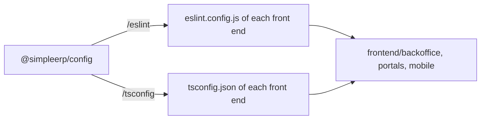

# @simpleerp/config

`@simpleerp/config` holds the ESLint and strict TypeScript settings that every SimpleERP front end shares: the
back office, the customer and supplier portals and the mobile app. Each front end extends these settings instead of
writing its own, so that the lint and type rules of [D407](../../../docs/specs/06-decisions/technical/d407-front-end.md)
(Vue 3 with TypeScript) apply the same way everywhere. The package lives in `frontend/packages/config/`, as the
shared packages of [D438](../../../docs/specs/06-decisions/technical/d438-repository-layout.md) do.

## What the package exports

| Import path | File | Holds |
| --- | --- | --- |
| `@simpleerp/config/eslint` | `eslint.base.js` | The shared ESLint flat configuration |
| `@simpleerp/config/tsconfig` | `tsconfig.base.json` | The strict TypeScript compiler options |

The package is private to the workspace. It is never published.

## Using the settings in a front end

A front end under `frontend/backoffice/`, `frontend/portals/<portal>/` or `frontend/mobile/` uses the package in three
steps.

1. Add `@simpleerp/config` as a development dependency, with the workspace version:

   ```json
   "devDependencies": {
     "@simpleerp/config": "workspace:*"
   }
   ```

2. Extend the ESLint settings from `eslint.config.js`:

   ```js
   import shared from "@simpleerp/config/eslint";

   export default [...shared];
   ```

3. Extend the strict TypeScript options from `tsconfig.json`, and give the front end its own `include`:

   ```json
   {
     "extends": "@simpleerp/config/tsconfig",
     "include": ["src/**/*.ts", "src/**/*.vue"]
   }
   ```



## Scripts

Run them from the repository root, with the pnpm filter of [AGENT.md](../../../AGENT.md):

| Script | Command | Does |
| --- | --- | --- |
| `lint` | `pnpm --filter ./frontend/packages/config run lint` | Runs `eslint .` on the package |
| `typecheck` | `pnpm --filter ./frontend/packages/config run typecheck` | Runs `tsc --noEmit -p tsconfig.json` |
| `test` | `pnpm --filter ./frontend/packages/config run test` | Runs `vitest run` on the package tests |

## Tests and fixtures

The tests in `frontend/packages/config/tests/` show that the shared settings apply. `tests/fixtures/` holds
deliberately broken fixture front ends: `eslint-front-end/` breaks the lint rules, and `strict-front-end/` breaks the
strict type rules. The tests run the shared settings on them and expect the errors. A fixture is never a real front
end and is never built: its errors are the point.
