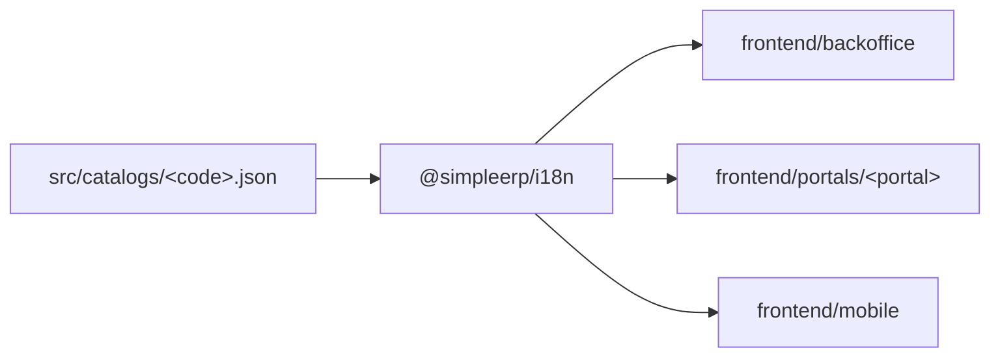

# @simpleerp/i18n

The internationalisation package of the SimpleERP front ends. It holds the message catalogues of each language, the
formatting of dates, numbers and money per locale, and the Vue plugin that applies the user's language to an app
without a reload.

## What the package holds

- **Message catalogues per language.** French and English at launch ([D21](../../../docs/specs/06-decisions/foundations/d21-languages.md)).
  Every text of the screens lives in these files, so that a community member or a plugin can add a language
  ([Localisation](../../../docs/specs/05-non-functional/localisation.md)).
- **Formatting per locale.** Dates, numbers and money are formatted for the locale the caller passes.
- **Exact money.** Money is an exact decimal with its currency, so a formatted sum keeps every digit it was given, with no
  float error ([REQ-T10-03](../../../docs/specs/03-technical/t10-translations-and-notifications/requirements/req-t10-03-money-decimals.md)).
- **The user's language, applied at once.** Switching language re-renders the components that show text, without
  reloading the page.
- **The missing-key check.** A key present in one language and absent from another fails the test suite, so a key added
  in English only cannot reach CI ([REQ-T10-01](../../../docs/specs/03-technical/t10-translations-and-notifications/requirements/req-t10-01-translation-catalogues.md)).
  The review workflow of the translations (a machine draft, then a human review) comes in phase P2.

## Where it sits

The package is one of the shared TypeScript packages of `frontend/packages/`, built on the design system's tokens, and
used by the front ends `frontend/backoffice/` and `frontend/portals/<portal>/` and `frontend/mobile/`
([D438](../../../docs/specs/06-decisions/technical/d438-repository-layout.md),
[D407](../../../docs/specs/06-decisions/technical/d407-front-end.md),
[Frontend architecture](../../../docs/technical/architecture/frontend.md)).



The package is published to the other packages by its name, `@simpleerp/i18n`, through its `src/index.ts` entry point.

## Layout

| Path | Holds |
| --- | --- |
| `src/index.ts` | The public API: `createI18n`, `I18N_KEY`, `useI18n`, `catalogs`, `availableLanguages`, `findMissingKeys`, `formatMoney`, `formatNumber`, `formatDate` |
| `src/types.ts` | The types of a catalogue, of the translator and of a missing key |
| `src/catalogs/<code>.json` | One catalogue per language, for example `en.json` and `fr.json` |
| `tests/` | The tests of the package, including the missing-key check |

## Add a key

Add the key to **every** `src/catalogs/<language>.json`, with its text in each language. The test suite compares the
catalogues and fails when a key is missing from one of them, so the change does not reach CI until each language has it.

## Add a language

Create `src/catalogs/<code>.json` with every key of the other catalogues. The package finds the new file and lists the
language in `availableLanguages`, with no code change.

## Use it in an app

An app installs the translator once, with the user's locale and the catalogues:

```ts
import { createI18n } from "@simpleerp/i18n";

app.use(createI18n({ locale, catalogs }));
```

A component reads it with `useI18n()`, which gives:

- `t`, the translation of a dotted key, with its placeholders filled from the parameters;
- `locale`, the active language, reactive;
- `setLocale`, which switches the language for the whole app.

The formatting functions take the locale as their last argument, so the caller chooses it:

- `formatMoney(amount: string, currency: string, locale: string)`, where `amount` is the exact decimal as a string;
- `formatNumber` and `formatDate`, which format a number or a date for that locale.

## Commands

Run them from the repository root:

```bash
pnpm --filter ./frontend/packages/i18n run lint
pnpm --filter ./frontend/packages/i18n run typecheck
pnpm --filter ./frontend/packages/i18n run test
```

## Specifications

- [D21 Languages](../../../docs/specs/06-decisions/foundations/d21-languages.md)
- [Localisation](../../../docs/specs/05-non-functional/localisation.md)
- [REQ-T10-01 Translation catalogues reviewed](../../../docs/specs/03-technical/t10-translations-and-notifications/requirements/req-t10-01-translation-catalogues.md)
- [REQ-T10-03 Money as exact decimals](../../../docs/specs/03-technical/t10-translations-and-notifications/requirements/req-t10-03-money-decimals.md)
