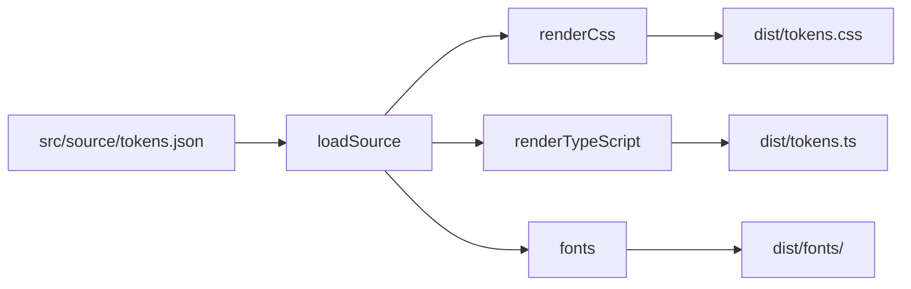

# @simpleerp/tokens

The design tokens of SimpleERP: the colours, spacing, density, typography, radius and elevation values that every front
end uses, in light and dark themes. The values follow the [design tokens](../../../docs/specs/04-ux/design-system/tokens.md)
page, the [colours](../../../docs/specs/04-ux/visual-identity/colours.md) and the
[typography](../../../docs/specs/04-ux/visual-identity/typography.md) pages, and the decisions
[D41](../../../docs/specs/06-decisions/ux/d41-indigo-primary.md) (indigo primary),
[D42](../../../docs/specs/06-decisions/ux/d42-density-per-role.md) (density per role),
[D43](../../../docs/specs/06-decisions/ux/d43-light-and-dark.md) (light and dark) and
[D44](../../../docs/specs/06-decisions/ux/d44-typefaces.md) (typefaces).

The package is built on the front-end decision [D407](../../../docs/specs/06-decisions/technical/d407-front-end.md) and
the repository layout of [D438](../../../docs/specs/06-decisions/technical/d438-repository-layout.md). Its place in the
front-end design is described in [the front-end design page](../../../docs/technical/architecture/frontend.md).

## What the package holds

- **Colours** of the Tokens, in light and dark: primary, accent, success, error, warning, text, surfaces, borders and
  raised surfaces.
- **Spacing**, the scale of steps used for margins and paddings.
- **Density**, the row height, cell padding, field height and body size of the comfortable and compact densities.
- **Typography**, the three typefaces served by the package (D44): Plus Jakarta Sans for headings, Inter for the body
  and JetBrains Mono for code, with the type styles of each.
- **Radius** and **elevation** values.

## Where the values live

All values live in `src/source/tokens.json`, the only file to edit. The TypeScript types that describe it are in
`src/source/token-source.ts`. Nothing else holds a value by hand: the build derives every output from these two files.

## Build and test

Run these commands from the root of the repository:

```bash
pnpm --filter ./frontend/packages/tokens run build
pnpm --filter ./frontend/packages/tokens run test
pnpm --filter ./frontend/packages/tokens run typecheck
```

- `build` writes the files of `dist/` (see below).
- `test` runs the Vitest suites: the source, the generators, the build and the contrast checks.
- `typecheck` runs the TypeScript compiler without emitting files.

## What the build writes

| File | Holds |
| --- | --- |
| `dist/tokens.css` | The font faces and the CSS variables of both themes and of both densities |
| `dist/tokens.ts` | The `tokens` constant, typed, with the same values as the CSS |
| `dist/fonts/` | The woff2 files of the three typefaces and their OFL licences |

## How a front end uses it

A front end imports the stylesheet once, at its entry point, and the typed values where it needs them:

```ts
import "@simpleerp/tokens/tokens.css";
import { tokens } from "@simpleerp/tokens";
```

The fonts are served from `@simpleerp/tokens/fonts/*`, as the font faces of `tokens.css` point to them.

## Theme

Set `data-theme="light"` or `data-theme="dark"` on the root element to choose the theme. Without that attribute, the
device setting is followed through `prefers-color-scheme` (D43).

## Density

Set `data-density="compact"` on the root element for the compact density. The comfortable density is the default. Phones
under 768 px always use the comfortable density, whatever the attribute says (D42).

## CSS variable names

| Prefix | Holds |
| --- | --- |
| `--color-*` | The colours of the current theme, for example `--color-primary` and `--color-text-muted` |
| `--space-*` | The spacing scale |
| `--row-height`, `--cell-padding`, `--field-height`, `--body-size` | The values of the current density |
| `--font-family-*` | The families of the headings, the body and the code |
| `--font-*` | The type styles: size, line height and weight |
| `--radius-*` | The radius values |
| `--elevation-*` | The elevation (shadow) values |

## Contrast

Every text colour pair is checked by a test against the [colours](../../../docs/specs/04-ux/visual-identity/colours.md)
page, for both themes, to meet the contrast ratios of the [accessibility standard](../../../docs/specs/06-decisions/ux/d46-accessibility-standard.md)
(D46). A pair that falls below the ratio fails the test, so the build cannot ship a low-contrast text colour.

## How the build works


