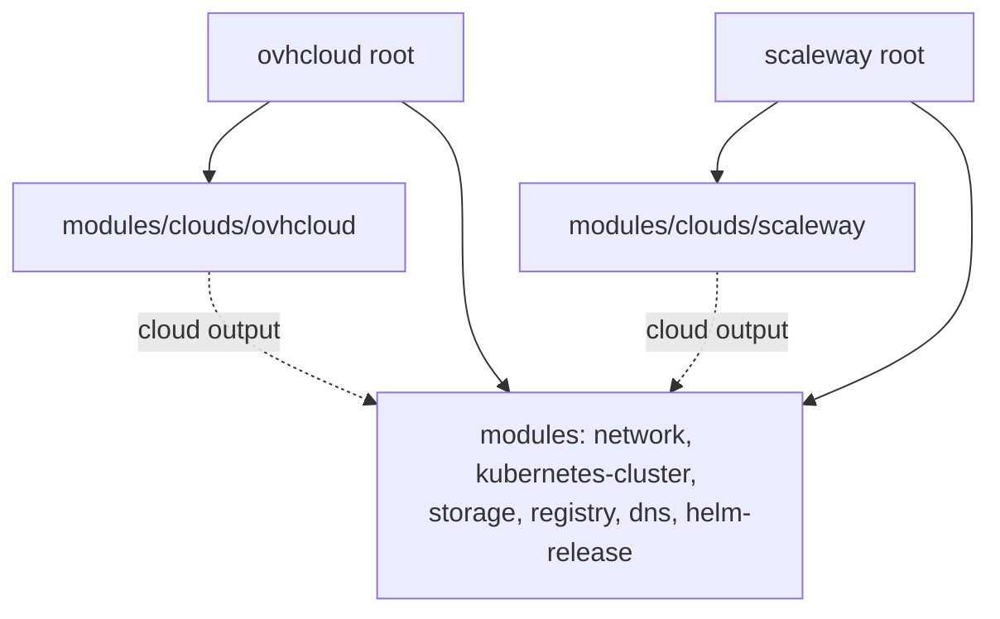

# infra/terraform

The Terraform code of the infrastructure ([D421](../../docs/specs/06-decisions/technical/d421-infrastructure-cncf.md),
[D438, the repository layout](../../docs/specs/06-decisions/technical/d438-repository-layout.md)). It is a skeleton:
the modules hold no resource yet, and the working deployment (REQ-T09-08) comes in phase P2, with ticket T9. This
folder holds the interfaces the later tickets of phase P0 fill in, the two roots that call them, and the checks run
in CI.

## Layout



| Path | Holds |
|---|---|
| `modules/` | The six interface modules, cloud-neutral: `network`, `kubernetes-cluster`, `storage`, `registry`, `dns`, `helm-release` |
| `modules/clouds/ovhcloud/`, `modules/clouds/scaleway/` | The provider modules: each one publishes its `cloud` output (its name and region) and reads no credential itself |
| `ovhcloud/`, `scaleway/` | The two roots: each one calls the cloud module, then the six interface modules |

Each module folder has its `versions.tf`, `variables.tf`, `main.tf`, `outputs.tf` and a `tests/` folder of
`terraform test` files.

## The interface modules

| Module | Input | Output |
|---|---|---|
| `network` | `cloud`, `name`, `cidr` | `network`: the cloud, region, name and address range |
| `kubernetes-cluster` | `cloud`, `name`, `network` | `cluster` |
| `storage` | `cloud`, `name` | `storage` |
| `registry` | `cloud`, `name` | `registry` |
| `dns` | `cloud`, `name`, `domain` | `dns` |
| `helm-release` | `cloud`, `name`, `cluster` | `release` |

The provider modules output `cloud`, an object of `name` (`ovhcloud` or `scaleway`) and `region`. The interface
modules validate it, so a wrong cloud name is refused before any resource exists.

## The two roots

`ovhcloud/` and `scaleway/` declare the same variables (`name`, `region`, `domain`, `network_cidr`) and the same
calls to the six modules. They differ only in the source of `module "cloud"` and in their provider: `ovh/ovh` 2.26.0
for OVHcloud, `scaleway/scaleway` 2.93.0 for Scaleway. Both pin Terraform `1.17.2`, and each commits its
`.terraform.lock.hcl`.

## Credentials

No file holds a credential or a value of one. Each provider reads its own environment variables at apply time: the
`OVH_*` family for OVHcloud and the `SCW_*` family for Scaleway. Set them in the shell or the secret store of the
operator, never in a `.tf` or `.tfvars` file.

## State

No backend is declared. The operator chooses where the state lives. `.gitignore` keeps local state (`*.tfstate`,
`.terraform/`), variable files (`*.tfvars`, `*.tfvars.json`) and overrides out of git, and the module lock files
(`modules/**/.terraform.lock.hcl`) too, because only the roots pin providers.

## Check locally

Run these from the root of the repository. They are the commands of CI (`terraform.yml`):

```bash
terraform fmt -check -recursive infra/terraform
terraform -chdir=infra/terraform/ovhcloud init -backend=false -input=false
terraform -chdir=infra/terraform/ovhcloud validate
terraform -chdir=infra/terraform/ovhcloud test
```

Replace `ovhcloud` with `scaleway`, or with a module folder under `modules/`, for the other folders. `init` needs no
credential because it does not contact a cloud, and `test` runs against the modules' own tests.

## Status

The modules and the roots are interfaces without resources, so `apply` creates nothing. The working deployment, with
the cluster, the network and the registry built on each cloud, is the work of phase P2 (T9), under REQ-T09-08. The
target design of the infrastructure is in
[Infrastructure deployment](../../docs/technical/infrastructure/infrastructure.md), and the repository layout in
[the repository layout design page](../../docs/technical/architecture/repository-layout.md).
